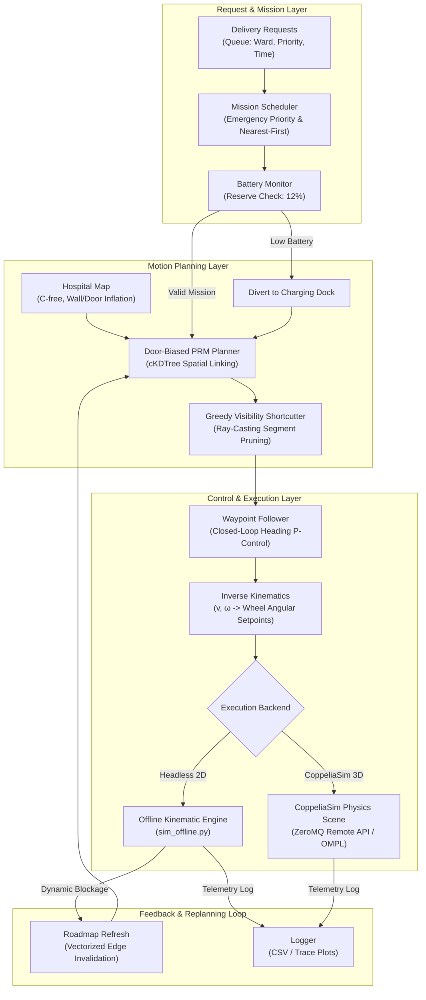

# MediRoute: Autonomous Hospital Delivery Robot with Probabilistic Roadmap (PRM)

[](https://www.python.org/downloads/)
[](https://www.coppeliarobotics.com/)
[](https://ompl.kavrakilab.org/)
[](LICENSE)
[](https://www.upes.ac.in)

> **CSAI4014 Algorithms for Intelligent Systems and Robotics — B.Tech CSE (AI & ML), Semester VII**  
> **School of Computer Science, UPES, Dehradun**  
> **Project No.:** P05 | **Group No.:** G01 | **Batch:** B3  
> **Team Members:** Supreet Kaur (500122005), Aditi Verma (500123675), Parag Goyal (500124297), Kushal Gupta (500121188), Aman Rathore (500122510)

---

## Table of Contents
- [Project Overview](#project-overview)
- [Key Engineering Novelties](#key-engineering-novelties)
- [System Architecture](#system-architecture)
- [Hospital Floor Geometry & Delivery Targets](#hospital-floor-geometry--delivery-targets)
- [Mathematical Formulation](#mathematical-formulation)
  - [1. Configuration Space & Obstacle Inflation](#1-configuration-space--obstacle-inflation)
  - [2. Differential-Drive Unicycle Kinematics](#2-differential-drive-unicycle-kinematics)
  - [3. Closed-Loop Heading Proportional Control](#3-closed-loop-heading-proportional-control)
  - [4. Battery Kinetic Depletion Model](#4-battery-kinetic-depletion-model)
- [Repository Structure & Module Decomposition](#repository-structure--module-decomposition)
- [Prerequisites & Installation](#prerequisites--installation)
- [Execution & Quickstart Guide](#execution--quickstart-guide)
  - [1. Verification Unit Tests](#1-verification-unit-tests)
  - [2. Offline Kinematic Mission (Dynamic Events & Battery)](#2-offline-kinematic-mission-dynamic-events--battery)
  - [3. Statistical Monte Carlo Benchmarks](#3-statistical-monte-carlo-benchmarks)
  - [4. CoppeliaSim 3D Physics Integration](#4-coppeliasim-3d-physics-integration)
- [Request Dispatching Syntax](#request-dispatching-syntax)
- [Empirical Benchmark Results](#empirical-benchmark-results)
  - [Experiment 1: Milestone Count ($N$) vs. Success Rate](#experiment-1-milestone-count-n-vs-success-rate)
  - [Experiment 2: Narrow Passage Doorway Constriction](#experiment-2-narrow-passage-doorway-constriction)
  - [Experiment 3: Multi-Query Roadmap Reuse Speedup](#experiment-3-multi-query-roadmap-reuse-speedup)
  - [Experiment 4: End-to-End Multi-Ward Mission Execution](#experiment-4-end-to-end-multi-ward-mission-execution)
- [Overleaf Academic Report](#overleaf-academic-report)
- [Team Technical Contribution Matrix](#team-technical-contribution-matrix)
- [References](#references)

---

## Project Overview

In contemporary healthcare facilities, medical and nursing staff expend 25%–35% of their working hours manually transporting pharmaceuticals, intravenous fluids, sterile laboratory samples, and surgical consumables between central supply depots and patient wards. **MediRoute** is an autonomous mobile robot navigation and mission executive framework engineered specifically for indoor hospital logistics.

Unlike industrial warehouses with segregated, wide corridors, hospital floors feature **narrow doorways (0.65 m – 1.0 m)**, high-frequency inter-room multi-query dispatching, and dynamic transient disturbances (such as roaming healthcare staff and parked trolleys). MediRoute leverages a **Probabilistic Roadmap (PRM)** planner enhanced with:
1. **Targeted Door-Biased Sampling** to eliminate the classical narrow-passage planning failure mode.
2. **Non-Destructive Roadmap Refresh** that repairs invalid graph edges without discarding milestone spatial indices.
3. **Closed-Loop Heading Proportional Control** with Lyapunov-stable speed suppression to prevent corner-cutting.
4. **Energy-Aware Task Preemption** that autonomously diverts the robot to a charging dock prior to battery depletion.
5. **Unified Dual Simulation Backends**: high-speed 2D kinematic simulation for hundreds of Monte Carlo sweeps, and a 3D CoppeliaSim robotics environment operating via the ZeroMQ remote API.

---

## Key Engineering Novelties

1. **Door-Biased PRM Sampling:**  
   Standard uniform random sampling yields near-zero probability of landing milestones inside narrow doorways ($\mu(\mathcal{C}_{\text{door}}) \ll \mu(\mathcal{C})$), causing disconnected roadmaps. MediRoute seeds each doorway with a stochastic bounding box distribution ($M$ samples) and a deterministic 3-point topological anchor set ($\mathbf{p}_{\text{center}}, \mathbf{p}_{\text{in}}, \mathbf{p}_{\text{out}}$).  
   *Result:* Maintains **100.0% planning success** even at constricted $0.65\text{ m}$ door clearances where uniform PRM plummets to $3.3\%$.

2. **Non-Destructive Topological Roadmap Refresh:**  
   When dynamic obstacles (e.g., a pedestrian or supply trolley) block a hallway, conventional approaches discard the graph and re-sample. MediRoute preserves all node coordinates $V$ and the `cKDTree` index, executing vectorized edge re-validation against the updated obstacle polygon list in $< 0.01\text{ s}$.

3. **Integrated Battery & Priority Mission Scheduling:**  
   The mission executive estimates projected energy consumption across roadmap shortest paths:
   $$\hat{E}_{\text{req}} = 1.2 \times \Big( c_{\text{motion}} \cdot \hat{L}(\mathbf{p}_{\text{robot}}, \mathbf{p}_{\text{ward}}) + c_{\text{motion}} \cdot \hat{L}(\mathbf{p}_{\text{ward}}, \mathbf{p}_{\text{dock}}) \Big)$$
   If $E_{\text{current}} - \hat{E}_{\text{req}} < E_{\text{reserve}} = 12.0\%$, delivery is preempted, the robot docks, charges at $5.0\%/\text{s}$, and resumes queued missions. Emergency requests (`:E`) are immediately prioritized via a priority queue.

4. **Dual-Backend Architectural Abstraction:**  
   The same core mission executive, priority queue, battery model, and waypoint follower drive both:
   - A headless 2D kinematic simulator running at $> 500\times$ real-time speed.
   - A realistic 3D CoppeliaSim scene communicating via ZeroMQ Remote API with support for native PRM and OMPL algorithms (`PRM`, `PRM*`, `RRT-Connect`, `RRT*`).

---

## System Architecture



---

## Hospital Floor Geometry & Delivery Targets

The simulated hospital floor measures $10.0\text{ m} \times 8.0\text{ m}$ (coordinate space $x \in [-5.0, 5.0]$, $y \in [-4.0, 4.0]$). It consists of an unobstructed central transit corridor ($2.0\text{ m}$ wide), 5 dedicated rooms, and 5 standard interior doorways ($1.0\text{ m}$ nominal width).

```
+------------------+---------------------+-------------------+
|                  |                     |                   |
|  Pharmacy        |  Ward 1             |  Ward 2           |
|  (-3.5, +2.6)    |  (0.0, +2.6)        |  (+3.5, +2.6)     |
|                  |                     |                   |
+---[Door 1]-------+------[Door 2]-------+------[Door 3]----+
|                                                           |
| [Charging Dock]       Central Transit Corridor            |
| (-4.4, 0.0)           y in [-1.0, 1.0]                    |
|                                                           |
+--------[Door 4]-------------------[Door 5]----------------+
|                                   |                       |
|  Ward 3                           |  Ward 4               |
|  (-2.5, -2.6)                     |  (+3.0, -2.6)         |
|                                   |                       |
+-----------------------------------+-----------------------+
```

### Destination Landmark Coordinates
| Destination | X (m) | Y (m) | Operational Role |
|---|:---:|:---:|---|
| `Pharmacy` | $-3.5$ | $+2.6$ | Base station: payload replenishment & mission dispatch depot |
| `Ward1` | $0.0$ | $+2.6$ | Inpatient Ward 1 delivery station |
| `Ward2` | $+3.5$ | $+2.6$ | Inpatient Ward 2 delivery station |
| `Ward3` | $-2.5$ | $-2.6$ | Inpatient Ward 3 delivery station |
| `Ward4` | $+3.0$ | $-2.6$ | Inpatient Ward 4 delivery station |
| `ChargingDock` | $-4.4$ | $0.0$ | Automated high-rate battery recharge station ($5.0\%/\text{s}$) |

---

## Mathematical Formulation

### 1. Configuration Space & Obstacle Inflation
The mobile platform is a Pioneer P3-DX differential-drive robot with physical radius $r_{\text{robot}} = 0.22\text{ m}$ and safety buffer $r_{\text{safe}} = 0.05\text{ m}$, yielding an effective planning radius:
$$r_{\text{plan}} = r_{\text{robot}} + r_{\text{safe}} = 0.27\text{ m}$$

Each static rectangular obstacle $\mathcal{R}_k = [x_{\min,k}, x_{\max,k}] \times [y_{\min,k}, y_{\max,k}]$ is grown via Minkowski sum:
$$\tilde{\mathcal{R}}_k = [x_{\min,k} - r_{\text{plan}}, \, x_{\max,k} + r_{\text{plan}}] \times [y_{\min,k} - r_{\text{plan}}, \, y_{\max,k} + r_{\text{plan}}]$$

A point configuration $\mathbf{q} = (x, y) \in \mathcal{C}_{\text{free}}$ if and only if $\mathbf{q}$ lies within floor boundaries $\mathcal{W}$ and outside all inflated boxes:
$$\mathbf{q} \in \mathcal{C}_{\text{free}} \iff \forall k, \; \mathbf{q} \notin \tilde{\mathcal{R}}_k$$

### 2. Differential-Drive Unicycle Kinematics
Given wheel radius $r_w = 0.0975\text{ m}$ and axle track length $b = 0.381\text{ m}$:
$$\begin{bmatrix} \dot{x} \\ \dot{y} \\ \dot{\theta} \end{bmatrix} = \begin{bmatrix} \cos\theta & 0 \\ \sin\theta & 0 \\ 0 & 1 \end{bmatrix} \begin{bmatrix} v \\ \omega \end{bmatrix}$$

Forward velocity $v$ and angular rate $\omega$ map to individual wheel angular velocities $(\dot{\phi}_L, \dot{\phi}_R)$ via inverse kinematics:
$$\dot{\phi}_L = \frac{v - \frac{\omega b}{2}}{r_w}, \qquad \dot{\phi}_R = \frac{v + \frac{\omega b}{2}}{r_w}$$

### 3. Closed-Loop Heading Proportional Control
For current pose $(x, y, \theta)$ and waypoint $(x_g, y_g)$, heading error is computed with angle wrapping:
$$\theta_d = \text{atan2}(y_g - y, \, x_g - x), \qquad \tilde{e}_\theta = \text{atan2}(\sin(\theta_d - \theta), \, \cos(\theta_d - \theta)) \in [-\pi, \pi]$$

Yaw rate is governed by proportional feedback:
$$\omega = K_\omega \cdot \tilde{e}_\theta \quad (K_\omega = 2.5\text{ s}^{-1})$$

To eliminate corner clipping and lateral drift, forward speed is dynamically modulated by heading alignment and destination proximity:
$$v = \begin{cases} 0.0, & \text{if } |\tilde{e}_\theta| > 1.0\text{ rad} \approx 57.3^\circ \\ v_{\max} \cdot \cos(\tilde{e}_\theta), & \text{otherwise} \end{cases}$$
$$v_{\text{terminal}} = \min\left(v, \, 0.8 \|\Delta \mathbf{p}\|_2 + 0.03\right)$$

### 4. Battery Kinetic Depletion Model
Battery energy percentage $E(t)$ discharges with distance and quiescent idling:
$$E(t + \Delta t) = \max\left(0, \, E(t) - c_{\text{motion}} \cdot \|\Delta \mathbf{p}\|_2 - c_{\text{idle}} \cdot \Delta t\right)$$
where $c_{\text{motion}} = 2.0\%/\text{m}$ and $c_{\text{idle}} = 0.02\%/\text{s}$. Dock charging follows $\dot{E}_{\text{charge}} = 5.0\%/\text{s}$.

---

## Repository Structure & Module Decomposition

```
medirobot/
├── config.py             # Authoritative simulation hyperparameters & physical parameters
├── hospital_map.py       # Geometry of walls, doors, stops, and C-space Minkowski expansion
├── prm.py                # Door-biased sampling, cKDTree neighbor linking, Dijkstra, shortcutting
├── planners.py           # Standardized PRMPlanner wrapper with dynamic roadmap refresh
├── controller.py         # Waypoint follower, heading P-control, inverse kinematics
├── scheduler.py          # Priority queue, request parsing, nearest-first dispatching
├── battery.py            # Battery depletion tracking and automated recharge kinetics
├── mission.py            # High-level mission executive, dock diversions, replanning state-machine
├── sim_offline.py        # High-speed 2D kinematic simulator with dynamic obstacle events
├── coppelia_backend.py   # CoppeliaSim ZeroMQ remote API client & OMPL bindings
├── build_scene.py        # Procedural 3D hospital scene generator for CoppeliaSim
├── logger.py             # CSV execution metrics recorder
├── plots.py              # Matplotlib visualizer for roadmaps, trajectories, and benchmark sweeps
├── experiments.py        # Automated Monte Carlo benchmarking suite
├── main.py               # Unified CLI entry point
├── requirements.txt      # Python runtime dependencies
├── tests/
│   ├── __init__.py
│   └── test_core.py      # Automated unit tests (stops freedom, wall blocking, path search)
├── scenes/
│   └── hospital.ttt      # CoppeliaSim 3D hospital scene binary
├── results/              # Generated benchmark CSV datasets and high-res PNG plots
└── AISR_Hospital_Delivery_Robot_Report/  # Overleaf academic project report package
    ├── main.tex          # Complete LaTeX report (UPES formatting & single-line border)
    ├── references.bib    # Verified IEEE bibliography
    ├── upes_logo.png     # Official university header logo
    ├── figures/          # High-resolution benchmark figures
    ├── README.md         # Overleaf compilation instructions
    └── README.txt        # Package descriptor
```

---

## Prerequisites & Installation

### 1. Python Environment Setup
Python 3.9 or higher is required. It is recommended to use a clean virtual environment:

```bash
# Clone the repository
git clone https://github.com/Kushalgupta02/Hospital-Delivery-Robot-PRM.git
cd Hospital-Delivery-Robot-PRM

# Create and activate virtual environment
python3 -m venv venv
source venv/bin/activate  # On Windows: venv\Scripts\activate

# Install dependencies
pip install -r requirements.txt
```

### 2. Optional: CoppeliaSim Setup (for 3D Physics Backend)
1. Download and install **CoppeliaSim Edu 4.x** from [Coppelia Robotics](https://www.coppeliarobotics.com/).
2. Verify that the ZeroMQ Remote API client is installed (included in `requirements.txt` via `coppeliasim-zmqremoteapi-client`).

---

## Execution & Quickstart Guide

### 1. Verification Unit Tests
Validate the fundamental geometry, obstacle inflation, and planning continuity:
```bash
python3 -m unittest discover tests
```
*Expected output: `Ran 4 tests in ~0.26s ... OK`*

### 2. Offline Kinematic Mission (Dynamic Events & Battery)
Run a full multi-ward hospital delivery mission featuring battery management, an emergency dispatch arriving mid-mission, and a pedestrian stepping into the corridor:
```bash
python3 main.py offline \
    --requests Ward2 Ward4:E@20 Ward1 Ward3 \
    --dynamic \
    --battery 45
```
*Outputs generated:*
- Real-time terminal leg-by-leg execution metrics table.
- `results/delivery_log.csv`: recorded metrics per leg (latency, path length, time, battery, replans, collisions).
- `results/roadmap.png`: constructed PRM roadmap showing doorway milestone clustering.
- `results/run.png`: complete spatial trajectory trace across all wards and charging dock.

### 3. Statistical Monte Carlo Benchmarks
Run the automated benchmarking suite (10 trials per condition) evaluating sample density, doorway constriction, and roadmap reuse:
```bash
python3 main.py experiments --trials 10
```
*Outputs generated:*
- `results/exp_samples.csv` & `results/exp_samples.png`: Success rate and build latency vs. $N \in \{100, 200, 400, 800\}$.
- `results/exp_doors.csv` & `results/exp_doors.png`: Narrow passage evaluation vs. $w_{\text{door}} \in \{1.0, 0.8, 0.7, 0.65\}\text{ m}$.
- `results/exp_multi_query.csv`: Multi-query roadmap reuse speedup factor.

### 4. CoppeliaSim 3D Physics Integration
1. Launch CoppeliaSim Edu.
2. In a separate terminal, procedurally build the 3D hospital walls, furniture, floor, and delivery dummies:
   ```bash
   python3 main.py scene
   ```
3. In CoppeliaSim: drag a **Pioneer P3-DX** mobile robot model into the scene, ensure it is named `PioneerP3DX`, and save the scene to `scenes/hospital.ttt`.
4. Run the mission using our custom PRM planner or OMPL planners:
   ```bash
   # Run with custom PRM planner:
   python3 main.py coppelia --requests Ward2 Ward4 Ward1 --algo own

   # Run with OMPL PRM / RRT-Connect planner:
   python3 main.py coppelia --requests Ward2 Ward4 Ward1 --algo PRM
   # Supported algos: own, PRM, PRMstar, RRTConnect, RRTstar
   ```

---

## Request Dispatching Syntax

Requests passed to `--requests` support rich temporal and priority syntax:
- `Ward1`: Standard delivery request to Ward 1 (dispatched via nearest-first order).
- `Ward4:E`: High-priority **emergency** delivery request (served ahead of all non-emergency requests).
- `Ward4:E@20`: Timed emergency request that activates at simulation timestamp $t = 20.0\text{ s}$.

Example:
```bash
python3 main.py offline --requests Ward2 Ward4:E@15 Ward3 Ward1 --battery 50
```

---

## Empirical Benchmark Results

### Experiment 1: Milestone Count ($N$) vs. Success Rate
Evaluation across 6 inter-room query pairs over 10 randomized Monte Carlo trials:

| Milestones ($N$) | Door Bias | Success Rate (%) | Mean Build Time (s) | Mean Path Length (m) |
|:---:|:---:|:---:|:---:|:---:|
| 100 | False | 75.0% | 0.0176 s | 9.48 m |
| 100 | **True** | **96.7%** | 0.0260 s | **8.57 m** |
| 200 | False | 76.7% | 0.0314 s | 8.89 m |
| 200 | **True** | **100.0%** | 0.0399 s | **8.55 m** |
| 400 | False | 93.3% | 0.0598 s | 8.73 m |
| 400 | **True** | **100.0%** | 0.0680 s | **8.52 m** |
| 800 | False | 100.0% | 0.1174 s | 8.51 m |
| 800 | **True** | **100.0%** | 0.1232 s | **8.44 m** |

### Experiment 2: Narrow Passage Doorway Constriction
Fixed $N = 300$ samples across 10 randomized trials varying door width $w_{\text{door}}$:

| Door Width ($w$) | Uniform PRM Success | Door-Biased PRM Success | Observed Failure Mode (Uniform PRM) |
|:---:|:---:|:---:|---|
| $1.00\text{ m}$ | 80.0% | **100.0%** | Intermittent door disconnection (~1 in 5 queries fails) |
| $0.80\text{ m}$ | 40.0% | **100.0%** | Severe roadmap disconnection between wards |
| $0.70\text{ m}$ | 11.7% | **100.0%** | Near-total failure to find inter-room connections |
| $0.65\text{ m}$ | 3.3% | **100.0%** | Catastrophic failure (1 success per 30 queries) |

*Finding:* At $w = 0.65\text{ m}$, the collision-free passage aperture narrows to barely $0.11\text{ m}$ ($0.65 - 2 r_{\text{plan}}$). Door-biased sampling maintains **100% planning success** across all widths.

### Experiment 3: Multi-Query Roadmap Reuse Speedup
Evaluated across $Q = 60$ randomized inter-room queries:
- **Build Once & Reuse ($t_{\text{multi}}$):** `0.350 s` ($5.83\text{ ms}$ query latency)
- **Rebuild Roadmap for Each Query ($t_{\text{single}}$):** `4.526 s`
- **Net Computational Speedup:** **$12.95\times$**

### Experiment 4: End-to-End Multi-Ward Mission Execution
Logged execution metrics for initial battery $45\%$, emergency request `Ward4:E@20`, and pedestrian corridor event ($t = 15\text{s}$ to $60\text{s}$):

| Leg | Destination | Status | Plan Time (s) | Planned Len (m) | Time (s) | Replans | Battery (%) | Collisions |
|:---:|:---|:---:|:---:|:---:|:---:|:---:|:---:|:---:|
| 1 | `Ward3` | OK | 0.008 s | 7.61 m | 16.9 s | 1 | 33.8% | 0 |
| 2 | `ChargingDock` | OK | 0.005 s | 3.76 m | 12.2 s | 0 | 26.2% $\rightarrow$ 100% | 0 |
| 3 | `Ward1` | OK | 0.009 s | 12.93 m | 20.4 s | 1 | 86.4% | 0 |
| 4 | `Ward4` (Emergency) | OK | 0.005 s | 6.34 m | 19.5 s | 0 | 73.4% | 0 |
| 5 | `Ward2` | OK | 0.008 s | 8.77 m | 20.8 s | 1 | 59.7% | 0 |
| 6 | `Pharmacy` (Return) | OK | 0.010 s | 21.22 m | 32.1 s | 1 | 38.0% | 0 |

**Total Mission Time:** $144.5\text{ s}$ | **Collisions:** $0$ ($N_{\text{coll}} = 0$) | **Recharge Stops:** $1$

---

## Overleaf Academic Report

The repository contains a publication-ready academic project report conforming strictly to the official UPES School of Computer Science guidelines:
- Located in `AISR_Hospital_Delivery_Robot_Report/`.
- Features single-line outer page border (`eso-pic`), official UPES header logo, 1-page Index, List of Figures & Tables, Section 10 Contribution Table, and Section 11 Individual Co-learning Reflections.
- Pre-packaged archive available at `AISR_Hospital_Delivery_Robot_Report.zip`.
- Compatible with Overleaf (Compiler: **pdfLaTeX**).

---

## Team Technical Contribution Matrix

In accordance with course guidelines, the technical authorship and code contributions are divided as follows:

| Member Name & SAP ID | Technical Modules & Code Files Owned | Authored Report Sections |
|---|---|---|
| **Supreet Kaur**<br>(SAP: 500122005) | • `hospital_map.py` (floor geometry, bounding boxes)<br>• `tests/test_core.py` (automated verification tests)<br>• `references.bib` (IEEE citation database) | Abstract, Section 1 (Introduction), Section 2 (Problem Statement), Section 13 (References) |
| **Aditi Verma**<br>(SAP: 500123675) | • `config.py` (robot & simulation hyperparameters)<br>• `prm.py` (door-biased sampling formulation, narrow passage analysis) | Section 3 (Literature Review), Section 4 (Novelty) |
| **Parag Goyal**<br>(SAP: 500124297) | • `controller.py` (differential kinematics, Lyapunov heading control)<br>• `sim_offline.py` (2D kinematic engine & collision testing) | Section 5 (Syllabus Mapping & Theory), Section 6 (System Design) |
| **Kushal Gupta**<br>(SAP: 500121188) | • `prm.py` (PRM graph data structures, KD-Tree, Dijkstra, shortcutting)<br>• `planners.py` (roadmap refresh mechanism)<br>• `build_scene.py` & `coppelia_backend.py` (CoppeliaSim 3D backend) | Section 7 (Methodology & Algorithms), Section 8 (Simulation Setup) |
| **Aman Rathore**<br>(SAP: 500122510) | • `scheduler.py` (priority queue, nearest-first scheduling)<br>• `battery.py` (discharge model & dock replenishment)<br>• `mission.py`, `logger.py`, `experiments.py`, `plots.py` (benchmarking suite) | Section 9 (Results & Analysis), Section 12 (Conclusion & Future Scope), Appendix |

---

## References

1. L. E. Kavraki, P. Svestka, J.-C. Latombe, and M. H. Overmars, "Probabilistic roadmaps for path planning in high-dimensional configuration spaces," *IEEE Trans. Robot. Autom.*, vol. 12, no. 4, pp. 566–580, 1996.
2. S. M. LaValle, *Planning Algorithms*. Cambridge University Press, 2006.
3. S. Karaman and E. Frazzoli, "Sampling-based algorithms for optimal motion planning," *Int. J. Rob. Res.*, vol. 30, no. 7, pp. 846–894, 2011.
4. D. Hsu, J.-C. Latombe, and H. Kurniawati, "On the probabilistic foundations of probabilistic roadmap planning," *Int. J. Rob. Res.*, vol. 25, no. 7, pp. 627–643, 2006.
5. I. A. Şucan, M. Moll, and L. E. Kavraki, "The Open Motion Planning Library," *IEEE Robot. Autom. Mag.*, vol. 19, no. 4, pp. 72–82, 2012.
6. E. Rohmer, S. P. N. Singh, and M. Freese, "V-REP: A versatile and scalable robot simulation framework," in *Proc. IEEE/RSJ IROS*, 2013, pp. 1321–1326.
7. S. Thrun, W. Burgard, and D. Fox, *Probabilistic Robotics*. MIT Press, 2005.
8. R. Siegwart, I. R. Nourbakhsh, and D. Scaramuzza, *Introduction to Autonomous Mobile Robots*, 2nd ed. MIT Press, 2011.
9. K. J. Åström and R. M. Murray, *Feedback Systems: An Introduction for Scientists and Engineers*. Princeton University Press, 2008.
10. G. Fragapane, H. H. Hvolby, F. Sgarbossa, and J. O. Strandhagen, "Autonomous mobile robots in hospital logistics," in *APMS 2020*, IFIP AICT, vol. 591, pp. 672–679, 2020.
